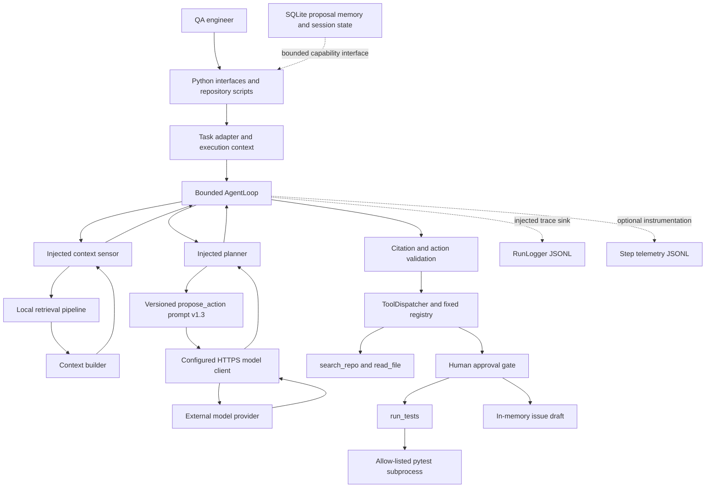

# 3. System Architecture

The Software-Engineering QA Agent is implemented as a modular Python codebase.
Its architecture separates retrieval and context preparation, model proposals,
deterministic validation, tool execution, memory, and observability. The model
proposes an action; application code and the human approval gate control what
may execute. The repository provides Python interfaces and command-line
scripts. It does not include a web interface or an automated GitHub publisher.

## 3.1 Request and evidence flow

The application session adapter validates the task contract and checks that the
registered tools match the task's declared tools. The `AgentLoop` then follows a
bounded sense, plan, validate, act, and observe cycle. It asks an injected stop
evaluator before the first turn and after each observation. A turn can dispatch
at most one tool action. A pending approval pauses the session for a human
decision; it does not cause an automatic resubmission.

Retrieval uses the local, provenance-tagged corpus. The retrieval pipeline
returns ranked chunks and an explicit `not_in_corpus` result. The context
builder packages evidence with source paths that can be checked by the citation
validator. Before context reaches the model, the builder redacts values matching
known credential patterns, neutralises evidence and memory delimiters in chunk
text, and flags injection-like content. The flagger identifies content for
review; it does not decide whether the content is safe or remove it.

The configured model client sends the versioned prompt and context to an
external HTTPS endpoint. Its response is parsed as a `ProposalSet` and treated
as untrusted data. Citation validation checks that cited paths were present in
the current context before an action reaches the dispatcher. The dispatcher
uses a fixed tool registry, role checks, tool-specific argument and output
validation, and the approval gate. `run_tests` executes an allow-listed
existing test node in a pytest subprocess with a stripped environment and
timeout. `draft_issue` stores a draft in memory after
approval; a person reviews and, if appropriate, posts it outside this
application.

## 3.2 Components and responsibilities

| Component | Responsibility | Main implementation |
| --- | --- | --- |
| Corpus and retrieval | Load provenance-tagged material, chunk and rank it locally, and report when evidence is absent | `src/ingestion/`, `src/rag/retrieval.py`, `src/rag/retriever.py` |
| Context and input safeguards | Assemble citeable context, redact credential patterns, neutralise reserved tags, and report injection flags | `src/rag/context_builder.py`, `src/rag/credential_scan.py`, `src/rag/injection_flagging.py` |
| Model boundary | Load a versioned prompt and call the configured provider through an HTTPS model adapter | `src/prompts/loader.py`, `src/models/client.py`, `src/config/loader.py` |
| Agent control | Keep each session bounded and coordinate injected sensing, planning, dispatch, stop evaluation, and trace interfaces | `src/agent/loop.py`, `src/agent/runner.py`, `src/agent/stop_conditions.py` |
| Validation and tools | Validate citations and route approved actions through the fixed tool registry | `src/orchestrator/`, `src/tools/`, `src/sandbox/executor.py` |
| Persistent memory | Store proposal status and explicit session state in SQLite; expose operations through a capability contract | `src/memory/`, `src/integration/mcp_interface.py` |
| Observability | Persist run events and optional step-level timing and outcome metadata as JSON Lines | `src/observability/run_logger.py`, `src/observability/telemetry.py`, `src/observability/instrumentation.py` |
| Evaluation | Run the combined offline scenario suites and collect their results | `tests/run_scenarios.py`, `src/evaluation/` |

## 3.3 Trust boundaries and controls

The model provider is external, and model output is never treated as an
authorization decision. Repository content is also untrusted: retrieval
preserves source provenance, the context builder applies the input safeguards,
and the validator rejects fabricated citations. The dispatcher is the only
route to registered tools. It checks roles and schemas, and delegates
approval-required actions to the human gate. Test execution is constrained by
the test-node allow-list, stripped environment, and timeout. The current
`SandboxExecutor` does not provide filesystem or network isolation: test code
retains the process's filesystem permissions and network access. The release
instructions and demonstration must therefore use reviewed, trusted test code;
this subprocess is not a security boundary for arbitrary untrusted tests.

Run traces and step telemetry support review of prompt version, retrieval
sources, proposed actions, tool status, duration, error type, and outcome. Step
telemetry stores metadata rather than prompt text, retrieved text, tool argument
values, tool output values, or exception messages. Memory is a separate
capability boundary: the `AgentLoop` does not call the memory store directly,
and a stored proposal does not grant permission to execute an action.

## 3.4 Implementation status

The repository implements the components and contracts above as Python modules
with offline scripts and tests. `AgentLoop` deliberately accepts its sensor and
planner as injected dependencies; the repository's demonstrations and
evaluation harnesses supply their own adapters. The current implementation has
no web UI, no GitHub API client, and no automated issue or pull-request
submission path. The test executor also lacks OS-level filesystem and network
isolation. These boundaries are relevant when reproducing the project:
the model call requires configured credentials, while the test suite and
scenario runner are designed to run offline.
